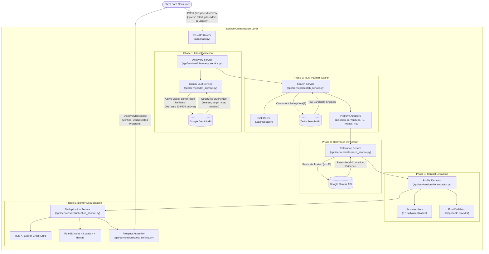
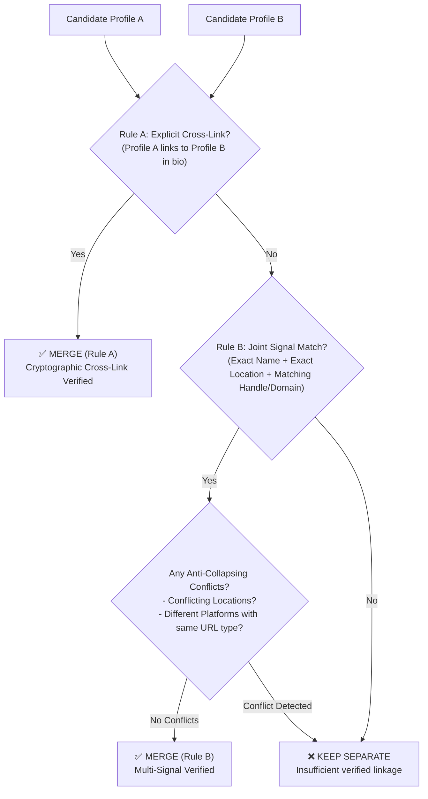
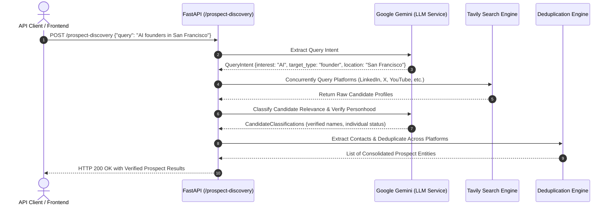
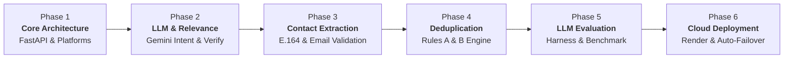

<div align="center">

```text
  ██████╗ ██████╗  ██████╗ ███████╗██████╗ ███████╗ ██████╗████████╗
  ██╔══██╗██╔══██╗██╔═══██╗██╔════╝██╔══██╗██╔════╝██╔════╝╚══██╔══╝
  ██████╔╝██████╔╝██║   ██║███████╗██████╔╝█████╗  ██║        ██║   
  ██╔═══╝ ██╔══██╗██║   ██║╚════██║██╔═══╝ ██╔══╝  ██║        ██║   
  ██║     ██║  ██║╚██████╔╝███████║██║     ███████╗╚██████╗   ██║   
  ╚═╝     ╚═╝  ╚═╝ ╚═════╝ ╚══════╝╚═╝     ╚══════╝ ╚═════╝   ╚═╝   
  ██████╗ ██╗███████╗ ██████╗ ██████╗ ██╗   ██╗███████╗██████╗ ██╗   ██╗
  ██╔══██╗██║██╔════╝██╔════╝██╔═══██╗██║   ██║██╔════╝██╔══██╗╚██╗ ██╔╝
  ██║  ██║██║███████╗██║     ██║   ██║██║   ██║█████╗  ██████╔╝ ╚████╔╝ 
  ██║  ██║██║╚════██║██║     ██║   ██║╚██╗ ██╔╝██╔══╝  ██╔══██╗  ╚██╔╝  
  ██████╔╝██║███████║╚██████╗╚██████╔╝ ╚████╔╝ ███████╗██║  ██║   ██║   
  ╚═════╝ ╚═╝╚══════╝ ╚═════╝ ╚═════╝   ╚═══╝  ╚══════╝╚═╝  ╚═╝   ╚═╝   
```

# AI PROSPECT DISCOVERY API

### *Autonomous Multi-Platform Prospecting Powered by AI & Real-Time Search.*

**An Asynchronous FastAPI Backend Service Engineered for Privacy-First, Zero-Fabrication Candidate Discovery and Multi-Signal Identity Deduplication**

<p align="center">
  <a href="https://ai-prospect-discovery-zb7m.onrender.com">
    
  </a>
  <a href="https://github.com/subhasankarsahu/ai-prospect-discovery/blob/main/LICENSE">
    
  </a>
  <a href="#">
    
  </a>
  <a href="#">
    
  </a>
  <a href="#">
    
  </a>
  <a href="#">
    
  </a>
  <a href="#">
    
  </a>
</p>

<p align="center">
  
</p>

<p align="center">
  AI Prospect Discovery API bridges natural language understanding with concurrent multi-platform search to automate professional prospecting from public web data.
  <br />
  Built with strict engineering discipline: zero synthetic hallucinations, verified identity deduplication (Rules A &amp; B), rate-limit resilience with automated model failover, and complete offline test determinism.
</p>

---

</div>

## Table of Contents

- [About the Project](#about-the-project)
- [Project Objectives](#project-objectives)
- [Key Features](#key-features)
  - [Query Understanding & Intent Engine](#query-understanding--intent-engine)
  - [Multi-Platform Search Orchestration](#multi-platform-search-orchestration)
  - [Relevance Classification & Personhood Verification](#relevance-classification--personhood-verification)
  - [Contact Signal Extraction & Normalization](#contact-signal-extraction--normalization)
  - [Identity Deduplication Engine](#identity-deduplication-engine)
  - [Infrastructure & Reliability](#infrastructure--reliability)
- [Technology Stack](#technology-stack)
  - [Architecture Overview](#architecture-overview)
  - [Detailed Component Breakdown](#detailed-component-breakdown)
- [System Architecture](#system-architecture)
  - [Request Flow Diagram](#request-flow-diagram)
  - [Architectural Principles](#architectural-principles)
- [Project Directory Structure](#project-directory-structure)
- [Supported Platform Adapters](#supported-platform-adapters)
- [Deduplication & Identity Resolution Rules](#deduplication--identity-resolution-rules)
- [Application Workflow](#application-workflow)
  - [Caller Journey](#caller-journey)
  - [Internal Processing Lifecycle](#internal-processing-lifecycle)
- [Getting Started](#getting-started)
  - [Prerequisites](#prerequisites)
  - [Local Installation](#local-installation)
  - [Environment Variables](#environment-variables)
  - [Running the Application](#running-the-application)
- [Live Cloud Deployment (Render)](#live-cloud-deployment-render)
  - [Production Endpoints](#production-endpoints)
  - [Deployment Specifications](#deployment-specifications)
  - [Cloud Verification Checklist](#cloud-verification-checklist)
- [API Specification](#api-specification)
  - [Health Check (`GET /health`)](#health-check-get-health)
  - [Prospect Discovery (`POST /prospect-discovery`)](#prospect-discovery-post-prospect-discovery)
- [Example Requests & Responses](#example-requests--responses)
  - [1. Successful Prospect Discovery](#1-successful-prospect-discovery)
  - [2. Non-Prospect Query Intent](#2-non-prospect-query-intent)
  - [3. Validation Failure (Empty Query)](#3-validation-failure-empty-query)
- [Error Handling & HTTP Status Codes](#error-handling--http-status-codes)
- [Testing Strategy & Verification](#testing-strategy--verification)
  - [Test Suite Execution](#test-suite-execution)
  - [Offline Determinism & Replay Fixtures](#offline-determinism--replay-fixtures)
- [LLM Evaluation Suite (Phase 5)](#llm-evaluation-suite-phase-5)
  - [Curated Datasets](#curated-datasets)
  - [Evaluation Metrics & Confidence Intervals](#evaluation-metrics--confidence-intervals)
  - [CLI Evaluation Runner](#cli-evaluation-runner)
- [Security & Privacy Architecture](#security--privacy-architecture)
- [Development Roadmap](#development-roadmap)
- [Contributing Guidelines](#contributing-guidelines)
- [License](#license)
- [Acknowledgements](#acknowledgements)

---

## About the Project

Finding targeted professionals, founders, developers, and agency executives across multiple platforms is traditionally a tedious, fragmented, and error-prone process. Recruiters and business development teams are forced to manually cross-reference LinkedIn, X (Twitter), YouTube, Instagram, Threads, and Facebook, or rely on brittle, invasive scrapers that violate privacy and break whenever web layouts change.

**AI Prospect Discovery API** was designed from the ground up as a production-grade, privacy-first alternative. Instead of scraping behind authenticated login walls or maintaining fragile DOM parsers, the API queries public search engine indexes across six major platforms simultaneously. It leverages **Google Gemini** for query understanding and personhood classification, uses Google's `libphonenumber` and strict regex validators for contact verification, and merges disparate social profiles into unified, deduplicated identities using deterministic identity resolution rules.

### Why This Project Matters
- **Zero Fabrication Guarantee:** Hallucinated contact points undermine business outreach. This API enforces a strict zero-fabrication invariant: if a name, location, email, or phone number cannot be extracted from verbatim public metadata, it is strictly omitted.
- **Resilient Upstream Fault-Tolerance:** Free-tier AI endpoints frequently suffer from transient 503 high-demand spikes. The API incorporates automated model normalization and immediate failover to `gemini-flash-lite-latest` with exponential backoff.
- **Deterministic Identity Resolution:** Merging people who share a common name (e.g., "John Smith") causes severe identity corruption. The deduplication engine requires cryptographic cross-profile URL links (Rule A) or verified joint evidence across name, location, and handle/domain (Rule B), with explicit anti-collapsing guards.
- **Zero-Budget Cloud Viability:** Architected to run entirely on free-tier cloud infrastructure ($0 total spend) with zero paid API overhead during tests and evaluations.

---

## Project Objectives

1. **Natural Language Interface:** Accept free-form user prompts (e.g., *"FinTech founders in London"* or *"Climate tech investors in Boston"*) and automatically decompose them into structured query parameters.
2. **Concurrent Multi-Platform Discovery:** Query up to 6 major professional and social platforms concurrently with intelligent rate-limiting and connection pooling.
3. **Evidence-Based Relevance Verification:** Apply LLM evaluation to eliminate corporate landing pages, brands, tools, and irrelevant search results, confirming that each accepted candidate represents an actual individual human.
4. **Strict Contact Validation:** Extract and validate only real, public contact coordinates (international E.164 phone numbers and non-disposable email addresses).
5. **Deterministic Multi-Signal Deduplication:** Consolidate multiple platform profiles into unified prospect entities without false merges or duplicate cards.
6. **100% Offline Test Determinism:** Maintain a 288-test automated test suite that executes in under 4 seconds without making any live external network requests.

---

## Key Features

> **Status Legend:**  
> ✅ **Implemented:** Fully functional, verified in code, and covered by automated tests.  
> 🔄 **In Progress:** Scaffolding complete; active refinement underway.  
> 📋 **Planned:** Architected and scheduled for upcoming releases.

### Query Understanding & Intent Engine

| Capability | Description | Status |
| :--- | :--- | :---: |
| **Natural Language Parsing** | Decomposes free-form search queries into `interest`, `target_type`, `audience`, and `location` | ✅ Implemented |
| **Non-Prospect Intent Guard** | Distinguishes prospecting queries from generic questions (e.g., *"What is the capital of France?"*), returning 0 prospects without wasting search credits | ✅ Implemented |
| **Structured Output Schema** | Enforces strict JSON Schema compliance via Gemini generation configuration | ✅ Implemented |
| **Automatic Model Normalization** | Transparently resolves preview or overloaded model aliases to high-availability endpoints | ✅ Implemented |

### Multi-Platform Search Orchestration

| Capability | Description | Status |
| :--- | :--- | :---: |
| **Multi-Platform Scoping** | Queries LinkedIn, X, YouTube, Instagram, Threads, and Facebook in targeted batches | ✅ Implemented |
| **Concurrency & Rate Throttling** | Manages outgoing search traffic with an asynchronous `Semaphore(3)` barrier | ✅ Implemented |
| **Local Disk Search Cache** | Caches search responses with SHA-256 query hashes and TTL to avoid duplicate API spend | ✅ Implemented |
| **Unrestricted Google Discovery** | Complements scoped platform searches with broad web search to catch non-indexed profile links | ✅ Implemented |

### Relevance Classification & Personhood Verification

| Capability | Description | Status |
| :--- | :--- | :---: |
| **Individual Personhood Verification** | Eliminates company pages, corporate blogs, tools, and brand directories | ✅ Implemented |
| **Verbatim Name Enforcement** | Enforces that `name_as_written` must appear verbatim in candidate search text | ✅ Implemented |
| **Geographic Alignment** | Validates candidate geographic signals against the requested query location | ✅ Implemented |
| **Confidence Scoring & Audit Trail** | Assigns `low`, `medium`, or `high` confidence with an explicit one-sentence rationale | ✅ Implemented |

### Contact Signal Extraction & Normalization

| Capability | Description | Status |
| :--- | :--- | :---: |
| **E.164 Phone Formatting** | Parses and standardizes international phone numbers using Google's `phonenumbers` library | ✅ Implemented |
| **Email Sanitization & Validation** | Validates email syntax and blocks disposable, generic, and placeholder addresses | ✅ Implemented |
| **Cross-Platform Link Extraction** | Detects external social and portfolio links embedded within public bio descriptions | ✅ Implemented |
| **Zero Fabrication Invariant** | Omits unverified contact fields completely; never produces placeholder or synthetic data | ✅ Implemented |

### Identity Deduplication Engine

| Capability | Description | Status |
| :--- | :--- | :---: |
| **Rule A (Explicit Linkage)** | Merges profiles linked by explicit URLs found in candidate bios | ✅ Implemented |
| **Rule B (Signal Matching)** | Merges profiles sharing identical normalized names, verified locations, and matching handles/domains | ✅ Implemented |
| **Conflict & Anti-Collapsing Guards** | Prevents merges when locations conflict, names differ, or two URLs belong to the same platform | ✅ Implemented |
| **Canonical URL Normalization** | Strips tracking query parameters, trailing slashes, and locale prefixes (`/in/`, `/@`, `m.facebook.com`) | ✅ Implemented |

### Infrastructure & Reliability

| Capability | Description | Status |
| :--- | :--- | :---: |
| **Automatic 503/404 Failover** | Intercepts Gemini capacity spikes (503) or missing models (404) and automatically falls back to `gemini-flash-lite-latest` | ✅ Implemented |
| **Exponential Backoff** | Absorbs API burst rate limits with up to 4 retry attempts (1s, 2s, 4s, 8s backoff) | ✅ Implemented |
| **Live Cloud Deployment** | Deployed on Render with native ASGI Uvicorn workers and automated Git deployment | ✅ Implemented |
| **Health Probe Endpoints** | Provides dual `/health` and `/healthz` endpoints for cloud orchestrator monitoring | ✅ Implemented |

---

## Technology Stack

### Architecture Overview

```
┌────────────────────────────────────────────────────────────────────────┐
│                   AI PROSPECT DISCOVERY ARCHITECTURE                   │
├─────────────────────────┬──────────────────────────────────────────────┤
│ API Layer               │ FastAPI 0.162, Uvicorn 0.54, Pydantic v2     │
│ Asynchronous HTTP       │ HTTPX 0.28 (AsyncClient + Connection Pools)  │
│ AI & Search Providers   │ Google Gemini (Flash Lite), Tavily Search    │
│ Contact Validation      │ phonenumbers 9.0 (libphonenumber), Regex     │
│ Sanitization & Parsing  │ BeautifulSoup4, SoupSieve                    │
│ Configuration & Cache   │ Pydantic-Settings, SHA-256 Local Disk Cache  │
│ Code Quality & Testing  │ Pytest 9.2, Pytest-Asyncio, Ruff 0.17        │
│ Cloud Infrastructure    │ Render Web Services (Python 3.11, Free Tier) │
└─────────────────────────┴──────────────────────────────────────────────┘
```

### Detailed Component Breakdown

| Layer | Technology | Version | Purpose | Status |
| :--- | :--- | :--- | :--- | :---: |
| **Language Runtime** | [Python](https://www.python.org/) | `3.11+` | Asynchronous programming with type hints and modern async/await syntax | ✅ Active |
| **Web Framework** | [FastAPI](https://fastapi.tiangolo.com/) | `0.162.5` | High-throughput async REST API framework with automatic OpenAPI documentation | ✅ Active |
| **ASGI Server** | [Uvicorn](https://www.uvicorn.org/) | `0.54.0` | Production-grade ASGI server implementation | ✅ Active |
| **Data Validation** | [Pydantic](https://docs.pydantic.dev/) | `2.14.4` | Strict schema parsing, runtime validation, and JSON serialization | ✅ Active |
| **Environment Settings** | [Pydantic-Settings](https://docs.pydantic.dev/latest/concepts/pydantic_settings/) | `2.15.0` | Type-safe environment variable parsing via `.env` | ✅ Active |
| **HTTP Client** | [HTTPX](https://www.python-httpx.org/) | `0.28.1` | Async HTTP client supporting timeouts, backoff, and connection pooling | ✅ Active |
| **LLM Provider** | [Google Gemini](https://ai.google.dev/) | `gemini-flash-lite-latest` | Structured intent extraction and candidate relevance classification | ✅ Active |
| **Search Engine** | [Tavily Search API](https://tavily.com/) | REST API | Specialized search engine optimized for AI agents and domain scoping | ✅ Active |
| **HTML Sanitization** | [BeautifulSoup4](https://www.crummy.com/software/BeautifulSoup/) | `4.15.0` | Cleans raw search snippets and extracts text safely | ✅ Active |
| **Phone Validation** | [phonenumbers](https://github.com/daviddrysdale/python-phonenumbers) | `9.0.44` | Python port of Google's libphonenumber for strict E.164 parsing | ✅ Active |
| **Testing Framework** | [Pytest](https://docs.pytest.org/) | `9.2.0` | Complete test runner with fixtures, assertions, and test parameterization | ✅ Active |
| **Async Test Support** | [pytest-asyncio](https://pytest-asyncio.readthedocs.io/) | `1.5.0` | Native asynchronous test execution support | ✅ Active |
| **Linter & Formatter** | [Ruff](https://astral.sh/ruff) | `0.17.6` | Ultra-fast linter and formatter enforcing PEP 8 and clean architecture | ✅ Active |
| **Hosting Platform** | [Render](https://render.com/) | Cloud | Managed Python web service with automatic Git-triggered deployments | ✅ Active |

---

## System Architecture

### Request Flow Diagram



### Architectural Principles

1. **Strict Layered Decoupling:** Routes in `app/main.py` contain zero business logic; they validate incoming HTTP schemas and delegate directly to domain services. Services orchestrate domain logic and call platform adapters.
2. **Zero Fabrication:** If an individual’s phone number, email, or geographic location is not directly verifiable from the public search snippet, it is omitted. Synthetic placeholders are strictly banned.
3. **Resilient Failover:** Calls to upstream LLM endpoints automatically normalize model names and retry with exponential backoff on HTTP 429 and 503 status codes.
4. **Deterministic Deduplication:** Merging profiles requires explicit cryptographic or multi-signal corroboration. Name similarity alone is explicitly disallowed as a merge signal.
5. **Complete Offline Test Isolation:** Automated tests must never depend on live external network connections; all HTTP dependencies are mocked or replayed from deterministic fixtures.

---

## Project Directory Structure

```text
ai-prospect-discovery/
├── app/
│   ├── config.py                   # Runtime configuration using pydantic-settings
│   ├── main.py                     # FastAPI entrypoint, OpenAPI metadata, and routes
│   ├── schemas.py                  # Public request, response, and prospect models
│   ├── schemas_internal.py         # Internal platform and candidate classification schemas
│   ├── platforms/                  # Independent platform adapter modules
│   │   ├── base.py                 # PlatformSource abstract base interface
│   │   ├── linkedin.py             # LinkedIn public profile adapter
│   │   ├── x.py                    # X (Twitter) handle and profile adapter
│   │   ├── youtube.py              # YouTube channel and handle adapter
│   │   ├── instagram.py            # Instagram profile adapter
│   │   ├── threads.py              # Threads user adapter
│   │   └── facebook.py             # Facebook vanity/numeric profile adapter
│   ├── services/                   # Core business logic and orchestrators
│   │   ├── discovery_service.py     # Main multi-platform discovery coordinator
│   │   ├── llm_service.py           # Gemini LLM interface with model normalization and failover
│   │   ├── search_service.py        # Tavily search integration with concurrency and caching
│   │   ├── cache_service.py         # Local disk search cache with SHA-256 keys and TTL
│   │   ├── relevance_service.py     # Candidate classification and verbatim verification
│   │   ├── profile_extractor.py     # Public contact extraction (E.164 phones, emails)
│   │   ├── deduplication_service.py # Rules A & B deterministic identity deduplication engine
│   │   └── prospect_service.py      # Final Prospect model assembly and formatting
│   └── utils/                      # Shared utility functions and validators
│       └── validators.py           # Regex, E.164, and URL canonicalization validators
├── evaluation/                     # Phase 5 offline LLM evaluation framework
│   ├── datasets/                   # Curated ground-truth datasets (intents & candidates)
│   ├── ground_truth/               # Human annotation guides and ambiguity policies
│   ├── metrics/                    # Statistical metrics (Precision, Recall, F1, Wilson 95% CI)
│   ├── providers/                  # Evaluation providers (offline double & live Gemini adapter)
│   ├── review/                     # Disagreement analysis and human review ingestion
│   ├── runner/                     # CLI evaluation runner with $0 budget enforcement
│   └── reports/                    # Standardized 17-section model comparison reports
├── tests/                          # Automated pytest suite (288 tests, 100% offline)
│   ├── fixtures/                   # Sanitized JSON fixture recordings for deterministic replay
│   ├── test_cache_service.py       # Cache TTL and key generation tests
│   ├── test_deduplication_service.py # Rules A & B deduplication and anti-collapsing tests
│   ├── test_end_to_end.py          # Full pipeline discovery integration tests
│   ├── test_evaluation_datasets.py # Dataset integrity and schema tests
│   ├── test_evaluation_harness.py  # Evaluation harness and zero-budget guard tests
│   ├── test_llm_service.py         # Gemini intent, model normalization, and failover tests
│   ├── test_normalizers.py         # Phone, URL, and text normalizer unit tests
│   ├── test_orchestrator.py        # Multi-platform concurrent discovery orchestration tests
│   ├── test_platforms.py           # Platform adapter contract tests
│   ├── test_profile_extractor.py   # E.164 phone and email extraction tests
│   ├── test_prospect_service.py    # Prospect assembly and formatting tests
│   ├── test_relevance_service.py   # Candidate verification and personhood tests
│   ├── test_routes.py              # FastAPI route tests (/health, /prospect-discovery)
│   ├── test_sanitizer.py           # PII redaction and snippet sanitizer tests
│   ├── test_search_service.py      # Tavily search retry, timeout, and budget tests
│   ├── test_url_utils.py           # URL canonicalization and parameter stripping tests
│   └── test_validators.py          # Input validation and regex unit tests
├── render.yaml                     # Render Blueprint specification for cloud deployment
├── pyproject.toml                  # Project packaging, Ruff, and Pytest configuration
├── requirements.txt               # Production dependencies
├── requirements-dev.txt           # Development, linting, and testing dependencies
├── .python-version                 # Declared Python version (3.11)
├── .env.example                    # Template for environment configuration
├── AGENTS.md                       # Mandatory engineering standards and constraints
└── README.md                       # Project manual and technical documentation
```

---

## Supported Platform Adapters

The pipeline includes six specialized adapters, each adhering to the `PlatformSource` interface:

| Platform | Target Profile Patterns | Extraction Capabilities | Indexing Limitations |
| :--- | :--- | :--- | :--- |
| **LinkedIn** | `linkedin.com/in/{username}` | Public profile vanity paths, professional titles, full names | Login walls restrict full profile text; relies on public search engine snippets |
| **X (Twitter)** | `x.com/{handle}`, `twitter.com/{handle}` | Handles, display names, and public bios; filters status and tweet URLs | Character limits on public bios; explicit locations frequently omitted |
| **YouTube** | `youtube.com/@{handle}`, `youtube.com/channel/{id}` | Custom channel handles, channel names, and public descriptions | Channel bios often describe content rather than owner's personal identity |
| **Instagram** | `instagram.com/{handle}` | Public usernames and profile descriptions; filters `/p/`, `/reel/`, `/explore/` | High frequency of private profiles; search snippets frequently truncate bios |
| **Threads** | `threads.net/@{handle}` | Public Threads handles, user names, and short bio descriptions | Newer platform with lower search indexation density than legacy networks |
| **Facebook** | `facebook.com/{page}`, `facebook.com/profile.php?id={id}` | Vanity and numeric profile paths; preserves IDs for cross-linking | Privacy barriers on personal profiles; high mixture of business pages and groups |

---

## Deduplication & Identity Resolution Rules

The deduplication engine merges candidate records into unified prospects using two deterministic rules:



### 1. Rule A: Explicit Cross-Platform Linkage
- If Profile A contains a public hyperlink directly referencing Profile B (or vice versa), the two profiles are merged with high confidence.

### 2. Rule B: Verified Multi-Signal Matching
- Candidates are merged when **all three** criteria are met:
  1. **Name Match:** Exact match on normalized personal name.
  2. **Location Match:** Verifiably identical city or country in public metadata.
  3. **Handle / Domain Match:** Shared username handle across platforms or matching corporate email domain.

### 3. Anti-Collapsing & Conflict Isolation
- **Conflicting Locations:** Two profiles with identical names but differing geographic locations (e.g., "London" vs. "New York") are strictly preserved as separate individuals.
- **Multiple Profiles on the Same Platform:** Two distinct profile URLs on the same platform (e.g., two different LinkedIn profiles) can never be merged into one prospect.

---

## Application Workflow

### Caller Journey



### Internal Processing Lifecycle

1. **Validation:** Pydantic validates that `query` is non-empty and non-whitespace.
2. **Intent Parsing:** `app.services.llm_service` queries Gemini to extract interest, audience, target type, and location.
3. **Guard Evaluation:** If the query is non-prospecting (e.g., factual trivia), returns immediately with 0 prospects.
4. **Platform Search:** `app.services.search_service` queries Tavily with domain filters using an async semaphore (`max_concurrent = 3`).
5. **Relevance Verification:** `app.services.relevance_service` verifies that each candidate represents an individual human whose name appears verbatim in snippet text.
6. **Contact Enrichment:** `app.services.profile_extractor` validates public phone numbers (E.164) and email addresses.
7. **Identity Merging:** `app.services.deduplication_service` resolves cross-platform profiles using Rules A and B.
8. **Assembly:** Assembles final response payload and returns HTTP 200.

---

## Getting Started

### Prerequisites

Ensure the following tools are installed on your local machine:
- **Python 3.11+** — [Download Python](https://www.python.org/downloads/)
- **Git 2.40+** — [Download Git](https://git-scm.com/)
- Optional: Google Gemini API key and Tavily Search API key (for live search queries; not required for health check or offline test suites)

---

### Local Installation

1. **Clone the repository:**
   ```bash
   git clone https://github.com/subhasankarsahu/ai-prospect-discovery.git
   cd ai-prospect-discovery
   ```

2. **Create and activate a virtual environment:**
   - **Windows (PowerShell):**
     ```powershell
     python -m venv .venv
     .\.venv\Scripts\Activate.ps1
     ```
   - **Linux / macOS:**
     ```bash
     python3 -m venv .venv
     source .venv/bin/activate
     ```

3. **Install dependencies:**
   ```bash
   pip install --upgrade pip
   pip install -r requirements.txt
   pip install -r requirements-dev.txt
   ```

---

### Environment Variables

Configuration is loaded from environment variables using `pydantic-settings`. Copy the example environment template:

```bash
cp .env.example .env
```

*On Windows Command Prompt:*
```cmd
copy .env.example .env
```

| Variable | Type | Default Value | Required? | Description |
| :--- | :--- | :--- | :---: | :--- |
| `LLM_PROVIDER` | string | `gemini` | Optional | Active LLM provider identifier (`gemini`). |
| `GEMINI_API_KEY` | string | `""` | **For Live Calls** | Google Gemini API key. Optional for `/health` and offline test execution. |
| `GEMINI_MODEL` | string | `gemini-flash-lite-latest` | Optional | Model identifier (overloaded preview names are automatically normalized). |
| `TAVILY_API_KEY` | string | `""` | **For Live Calls** | Tavily Search API key. Optional for `/health` and offline test execution. |
| `REQUEST_TIMEOUT_SECONDS` | integer | `30` | Optional | Default outgoing HTTP timeout in seconds for LLM and search calls. |
| `SEARCH_CACHE_ENABLED` | boolean | `true` | Optional | Enable local disk caching for search responses. |
| `SEARCH_CACHE_DIR` | string | `.cache/search` | Optional | Local filesystem path for cached search responses. |
| `PHONE_DEFAULT_REGION` | string | `US` | Optional | Default two-letter ISO country code used for national phone parsing. |

---

### Running the Application

Start the local server using Uvicorn:

```bash
uvicorn app.main:app --reload --host 0.0.0.0 --port 8000
```

Once running, access the local endpoints in your browser:
- **Interactive Swagger UI:** [http://localhost:8000/docs](http://localhost:8000/docs)
- **ReDoc Documentation:** [http://localhost:8000/redoc](http://localhost:8000/redoc)
- **Health Check Probe:** [http://localhost:8000/health](http://localhost:8000/health)

---

## Live Cloud Deployment (Render)

The application is deployed live in production on **[Render](https://render.com)** as a high-availability Python Web Service.

### Production Endpoints

| Endpoint | Method | Purpose | Live URL |
| :--- | :---: | :--- | :--- |
| **API Base URL** | `GET` | Service root | `https://ai-prospect-discovery-zb7m.onrender.com` |
| **Swagger UI** | `GET` | Interactive API documentation | `https://ai-prospect-discovery-zb7m.onrender.com/docs` |
| **ReDoc UI** | `GET` | Technical documentation | `https://ai-prospect-discovery-zb7m.onrender.com/redoc` |
| **Health Check** | `GET` | Service liveness probe | `https://ai-prospect-discovery-zb7m.onrender.com/health` |
| **Health Alias** | `GET` | Cloud orchestrator probe | `https://ai-prospect-discovery-zb7m.onrender.com/healthz` |
| **Prospect Discovery** | `POST` | Primary search endpoint | `https://ai-prospect-discovery-zb7m.onrender.com/prospect-discovery` |

### Deployment Specifications

- **Service Type:** Web Service
- **Plan:** Free ($0 / month)
- **Environment:** Python 3.11+ (declared in `.python-version` and `render.yaml`)
- **Build Command:** `pip install -r requirements.txt`
- **Start Command:** `uvicorn app.main:app --host 0.0.0.0 --port $PORT`
- **Health Check Path:** `/health` (and `/healthz`)
- **Port:** Uses Render's dynamic `$PORT` environment variable

### Cloud Verification Checklist

Verify the live deployment using `curl`:

1. **Verify Health:**
   ```bash
   curl -s https://ai-prospect-discovery-zb7m.onrender.com/health
   # Response: {"status": "healthy"}
   ```

2. **Execute Live Prospect Query:**
   ```bash
   curl -X POST "https://ai-prospect-discovery-zb7m.onrender.com/prospect-discovery" \
        -H "Content-Type: application/json" \
        -d '{"query": "Startup founders in London"}'
   ```

3. **Verify Validation Rejection:**
   ```bash
   curl -X POST "https://ai-prospect-discovery-zb7m.onrender.com/prospect-discovery" \
        -H "Content-Type: application/json" \
        -d '{"query": "   "}'
   # Response: HTTP 422 Unprocessable Entity
   ```

---

## API Specification

### Health Check (`GET /health`)

Lightweight liveness and readiness probe for container orchestrators, load balancers, and monitoring systems.

- **URL:** `/health` (alias: `/healthz`)
- **Method:** `GET`
- **Authentication:** None required
- **Response (HTTP 200 OK):**
  ```json
  {
    "status": "healthy"
  }
  ```

---

### Prospect Discovery (`POST /prospect-discovery`)

Primary discovery endpoint. Translates natural language queries, queries platforms, verifies candidates, and returns deduplicated prospects.

- **URL:** `/prospect-discovery`
- **Method:** `POST`
- **Content-Type:** `application/json`

#### Request Schema (`DiscoveryRequest`)

| Field | Type | Required? | Constraints | Description |
| :--- | :--- | :---: | :--- | :--- |
| `query` | string | **Yes** | Min length: 1; Non-whitespace | The natural language prospect discovery search query. |

#### Response Schema (`DiscoveryResponse`)

| Field | Type | Description |
| :--- | :--- | :--- |
| `success` | boolean | Indicates whether the discovery pipeline completed successfully. |
| `query` | string | The original search query processed. |
| `total_prospects` | integer | Total count of verified, deduplicated prospects returned. |
| `prospects` | array[`Prospect`] | List of discovered prospect entities. |

#### Prospect Entity Model (`Prospect`)

| Field | Type | Description |
| :--- | :--- | :--- |
| `name` | string | Verified personal name of the prospect. |
| `location` | string \| object \| null | Verified location string or structured location object. |
| `social_link` | array[`SocialLink`] | List of verified public profile links across supported platforms. |

#### Social Link Model (`SocialLink`)

| Field | Type | Description |
| :--- | :--- | :--- |
| `platform` | string | Name of the platform (`LinkedIn`, `X`, `YouTube`, `Instagram`, `Threads`, `Facebook`). |
| `link` | string | Normalized, direct HTTPS URL to the public profile. |

---

## Example Requests & Responses

### 1. Successful Prospect Discovery

**Request:**
```http
POST /prospect-discovery HTTP/1.1
Host: localhost:8000
Content-Type: application/json

{
  "query": "Startup founders in London"
}
```

**Response (HTTP 200 OK):**
```json
{
  "success": true,
  "query": "Startup founders in London",
  "total_prospects": 2,
  "prospects": [
    {
      "name": "Jane Doe",
      "location": "London, United Kingdom",
      "social_link": [
        {
          "platform": "LinkedIn",
          "link": "https://linkedin.com/in/janedoe"
        },
        {
          "platform": "X",
          "link": "https://x.com/janedoe"
        }
      ]
    },
    {
      "name": "Alex Smith",
      "location": "London, United Kingdom",
      "social_link": [
        {
          "platform": "LinkedIn",
          "link": "https://linkedin.com/in/alexsmith"
        }
      ]
    }
  ]
}
```

---

### 2. Non-Prospect Query Intent

When the LLM determines the query is not seeking people or organizations, the API returns successfully with 0 prospects without wasting platform search calls.

**Request:**
```http
POST /prospect-discovery HTTP/1.1
Host: localhost:8000
Content-Type: application/json

{
  "query": "What is the capital of France?"
}
```

**Response (HTTP 200 OK):**
```json
{
  "success": true,
  "query": "What is the capital of France?",
  "total_prospects": 0,
  "prospects": []
}
```

---

### 3. Validation Failure (Empty Query)

When the query is empty or whitespace-only, Pydantic rejects the request with HTTP 422.

**Request:**
```http
POST /prospect-discovery HTTP/1.1
Host: localhost:8000
Content-Type: application/json

{
  "query": "   "
}
```

**Response (HTTP 422 Unprocessable Entity):**
```json
{
  "detail": [
    {
      "type": "value_error",
      "loc": ["body", "query"],
      "msg": "Value error, Query cannot be empty or whitespace only",
      "input": "   "
    }
  ]
}
```

---

## Error Handling & HTTP Status Codes

The API maps internal conditions to standard HTTP status codes:

| HTTP Status | Trigger Condition | Upstream Cause & Description |
| :--- | :--- | :--- |
| **`200 OK`** | Success | Query processed successfully. Returned even when zero candidates match. |
| **`422 Unprocessable Entity`** | `ValidationError` | Missing `query` field, empty string, whitespace-only query, or malformed JSON. |
| **`429 Too Many Requests`** | `LLMRateLimitError` or `SearchRateLimitError` | Downstream Gemini API or Tavily Search API rate limit exceeded. |
| **`502 Bad Gateway`** | `LLMResponseParsingError` or `SearchServiceError` | Upstream provider returned invalid JSON, malformed response, or service failure. |
| **`503 Service Unavailable`** | `LLMConfigurationError` or `SearchConfigurationError` | Upstream API key missing or service misconfigured. |
| **`504 Gateway Timeout`** | `LLMTimeoutError` or `SearchTimeoutError` | Upstream Gemini or Tavily request exceeded configured timeout budget. |

---

## Testing Strategy & Verification

### Test Suite Execution

The repository maintains **288 automated tests** covering all modules, platform adapters, deduplication rules, and error paths:

```bash
# Verify static analysis, linting, and formatting
ruff check .

# Execute full offline test suite
pytest -v
```

### Test Breakdown by Subsystem

```text
============================= test session starts =============================
platform win32 -- Python 3.11.16, pytest-9.2.0, pluggy-1.7.0
rootdir: C:\Users\subha\Downloads\ai-prospect-discovery
testpaths: tests

tests\test_cache_service.py .............. [  2%]  # SHA-256 caching & TTL
tests\test_deduplication_service.py ...... [  6%]  # Rules A & B deduplication
tests\test_end_to_end.py ................. [ 10%]  # Full pipeline discovery
tests\test_evaluation_datasets.py ........ [ 13%]  # Dataset integrity checks
tests\test_evaluation_harness.py ......... [ 17%]  # $0 budget guard verification
tests\test_llm_service.py ................ [ 22%]  # Gemini intent, normalizer & failover
tests\test_normalizers.py ................ [ 37%]  # E.164 phone & URL normalizers
tests\test_orchestrator.py ............... [ 46%]  # Concurrent search & rate limiting
tests\test_platforms.py .................. [ 48%]  # Platform adapter contract tests
tests\test_profile_extractor.py .......... [ 53%]  # Contact extraction & validation
tests\test_prospect_service.py ........... [ 55%]  # Prospect assembly & formatting
tests\test_relevance_service.py .......... [ 60%]  # Verbatim personhood verification
tests\test_routes.py ..................... [ 65%]  # /health & /prospect-discovery
tests\test_sanitizer.py .................. [ 69%]  # PII sanitization & redaction
tests\test_search_service.py ............. [ 73%]  # Tavily search retry & timeouts
tests\test_url_utils.py .................. [ 76%]  # URL parameter stripping
tests\test_validators.py ................. [100%]  # Schema & input validators

============================= 288 passed in 3.78s =============================
```

### Offline Determinism & Replay Fixtures

- **Zero-Network Policy:** Tests execute completely offline without network access.
- **Fixture Replay:** All network calls are intercepted with mocked transports or replayed from sanitized JSON fixtures in `tests/fixtures/`.
- **Async Test Pipeline:** Uses `httpx.AsyncClient` with `httpx.ASGITransport(app=app)` to test genuine ASGI async behavior without deprecation warnings.

---

## LLM Evaluation Suite (Phase 5)

An offline evaluation framework in `evaluation/` benchmarks LLM performance across the two core AI tasks:
1. **Query Intent Extraction:** Parsing unstructured prompts into structured parameters.
2. **Candidate Relevance Classification:** Distinguishing real individual persons from organizations and landing pages.

### Curated Datasets
- **Intent Queries (30 total):** 10 development queries (`evaluation/datasets/intents/development.json`) and 20 test queries (`evaluation/datasets/intents/test.json`).
- **Candidate Profiles (80 total across 7 platforms):** 30 development profiles (`evaluation/datasets/candidates/development.json`) and 50 test profiles (`evaluation/datasets/candidates/test.json`).

### Evaluation Metrics & Confidence Intervals
- **Strict $0 Budget Guard:** Default configuration enforces `budget_cap_usd = 0.0`. Live inference is blocked unless explicitly authorized.
- **Ambiguity Isolation:** Ambiguous ground-truth candidates are excluded from binary metrics and audited in a dedicated uncertainty log.
- **Wilson Score 95% Confidence Intervals:** Every metric reports 95% Wilson confidence intervals with automated small-sample warnings ($N < 30$).

### CLI Evaluation Runner

```bash
python -m evaluation.runner.run_evaluation
```

See [evaluation/README.md](file:///c:/Users/subha/Downloads/ai-prospect-discovery/evaluation/README.md) for complete evaluation documentation and reports.

---

## Security & Privacy Architecture

1. **Zero Fabrication Policy:** The service strictly prohibits synthetic contact creation. All names, locations, emails, and phone numbers must be present verbatim in public source metadata.
2. **Credential Protection:** Secrets (`GEMINI_API_KEY`, `TAVILY_API_KEY`) are managed strictly through environment variables via `pydantic-settings` and never hardcoded or committed.
3. **Repository Cleanliness:** Strict root `.gitignore` rules prevent accidental commits of `.env` files, local caches (`.cache/`), or virtual environments (`.venv/`).
4. **Automated PII Redaction:** All search snippets committed to repository test fixtures are scrubbed: personal emails and phone numbers are replaced with `REDACTED`.
5. **No Private Scraping:** Discovery relies exclusively on public, search-engine-indexed metadata. The API never bypasses authentication, circumvents login walls, or scrapes private user data.
6. **Responsible Outreach Compliance:** Discovered contacts must be utilized in strict compliance with applicable privacy and messaging laws (CAN-SPAM, GDPR, PECR).

---

## Development Roadmap



- **Phase 1: Foundations & Architecture** ✅
  - [x] FastAPI application entrypoint and route definitions
  - [x] Six independent platform adapters (`PlatformSource`)
  - [x] Tavily Search API client with caching and concurrency throttling
- **Phase 2: Query Intent & Candidate Relevance** ✅
  - [x] Gemini structured JSON intent extraction
  - [x] Non-prospect query detection
  - [x] Batch candidate relevance classification with verbatim verification
- **Phase 3: Public Contact Signal Extraction** ✅
  - [x] International E.164 phone parsing using `phonenumbers`
  - [x] Email validation with disposable domain blocklist
  - [x] Cross-platform social link discovery
- **Phase 4: Multi-Signal Identity Deduplication** ✅
  - [x] Rule A explicit cross-profile URL linkage
  - [x] Rule B verified joint signal matching (name + location + handle)
  - [x] Conflict isolation and anti-collapsing guards
- **Phase 5: Offline LLM Evaluation Suite** ✅
  - [x] Curated ground-truth datasets (30 intent queries, 80 candidate profiles)
  - [x] Offline double provider with $0 budget enforcement
  - [x] Wilson 95% confidence intervals and tabular review reporting
- **Phase 6: Cloud Deployment & Resilience** ✅
  - [x] Production deployment on Render Free Tier (`render.yaml`)
  - [x] Dual `/health` and `/healthz` monitoring probes
  - [x] Automatic Gemini model normalization and 503/404 failover

---

## Contributing Guidelines

To maintain code quality and clean Git history:

1. **Commit Message Conventions:** Follow [Conventional Commits](https://www.conventionalcommits.org/):
   - `feat: add new platform adapter for Bluesky`
   - `fix: resolve E.164 country code parsing edge case`
   - `docs: update API documentation`
   - `test: add unit tests for deduplication conflict rules`
2. **Quality Verification Before Committing:**
   ```bash
   ruff check .
   pytest -v
   ```
   Do not commit code that fails linting or tests.
3. **Privacy Hygiene:** Never commit unredacted PII or secret API keys to the repository.

---

## License

This project is open-source and available under the terms of the [MIT License](LICENSE).

---

## Acknowledgements

- Built with [FastAPI](https://fastapi.tiangolo.com/), [Pydantic v2](https://docs.pydantic.dev/), and [Uvicorn](https://www.uvicorn.org/).
- AI capabilities powered by [Google Gemini API](https://ai.google.dev/).
- Web search orchestration powered by [Tavily Search API](https://tavily.com/).
- International phone parsing powered by [Google libphonenumber (Python port)](https://github.com/daviddrysdale/python-phonenumbers).
- Badges generated using [Shields.io](https://shields.io/) and [Skill Icons](https://skillicons.dev/).

---

<div align="center">
  <sub>AI Prospect Discovery API &copy; 2026. All rights reserved.</sub>
</div>
